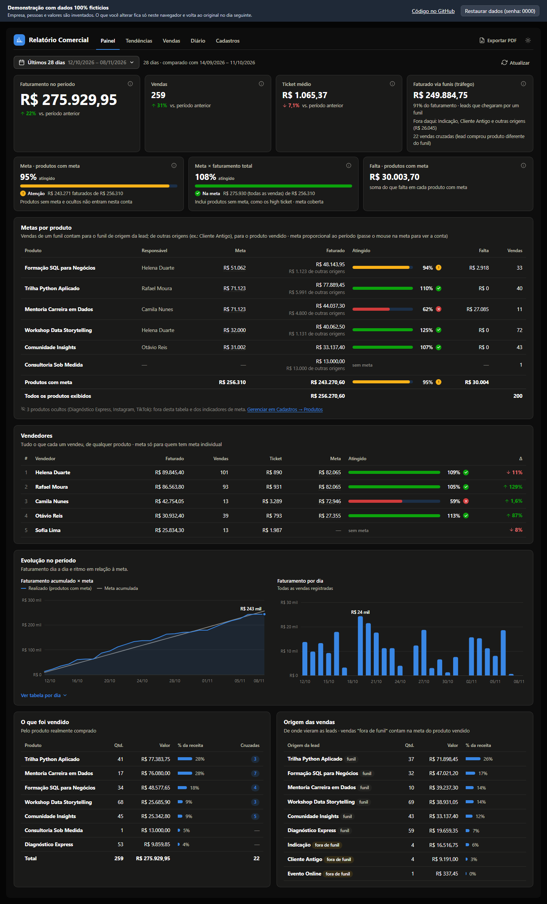
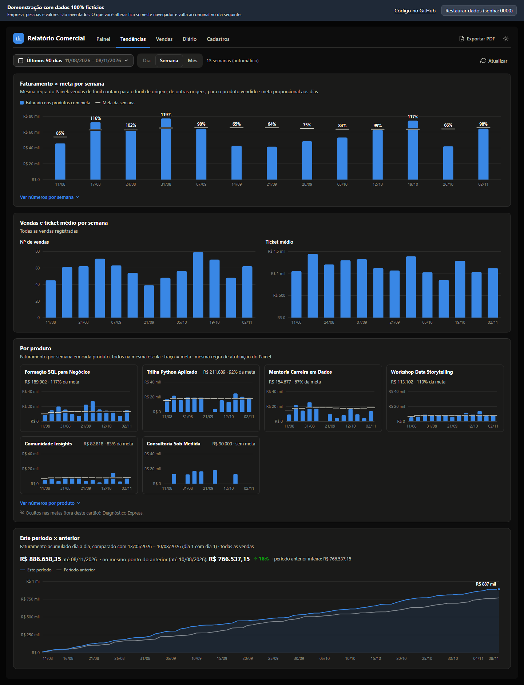
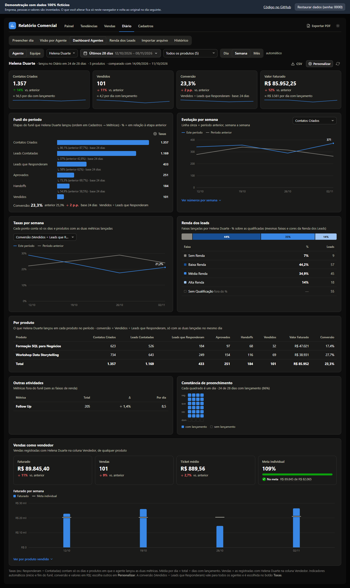
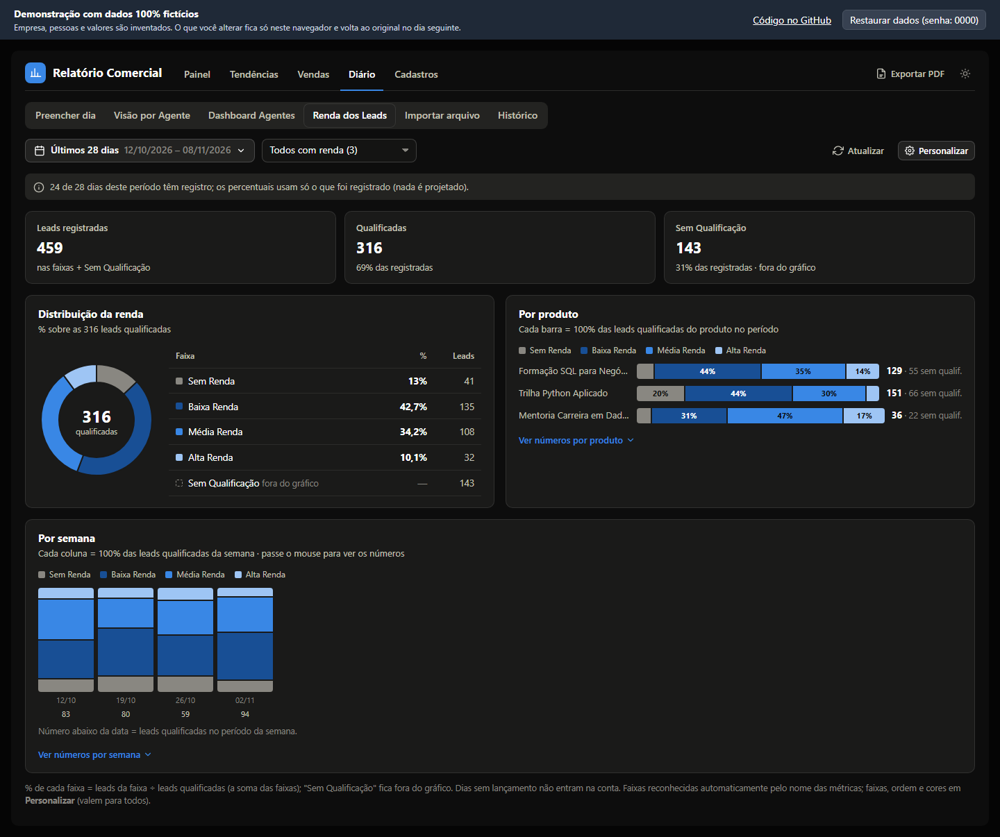
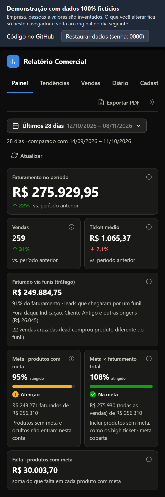
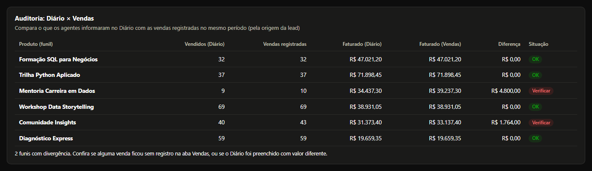

# Relatório Comercial Dinâmico

Painel de acompanhamento comercial que substituiu uma planilha semanal de vendas: faturamento × meta por produto e por vendedor, tendências, funil diário de cada agente, qualificação de leads por renda e auditoria entre o que foi informado e o que foi vendido.

**[▶ Abrir a demonstração](https://lucaselpidio.github.io/relatorio-comercial-dinamico/)** · roda no navegador, sem instalar nada.

> **Todos os dados da demonstração são fictícios.** Empresa, produtos, pessoas e valores foram inventados. O projeto foi construído para uma operação real; esta é a versão pública, sem nenhum dado dela.



---

## O problema

A operação acompanhava as vendas numa planilha semanal. Ela funcionava até certo ponto, mas:

- a semana era fixa: não dava para olhar "últimos 28 dias" ou "este mês" e comparar com o período anterior;
- as metas eram só semanais e, ao mudar uma meta, o histórico mudava junto;
- renomear um produto quebrava as fórmulas, e as listas tinham vagas fixas (15 produtos, 10 agentes);
- cerca de 37 linhas eram digitadas à mão por dia, e os erros só apareciam numa coluna de "situação";
- não havia como saber se o funil informado pelos agentes batia com as vendas registradas.

## O que o painel responde

| Pergunta do negócio | Onde |
|---|---|
| Estamos na meta? No ritmo certo para fechar o mês? | **Painel**: % atingido, quanto falta e ritmo ("57% do esperado até hoje") |
| Qual produto está acelerando ou caindo? | **Tendências**: faturamento × meta por dia, semana ou mês, e um mini-gráfico por produto |
| Quem está vendendo, e contra qual meta? | **Painel → Vendedores**: ranking com meta individual e variação |
| Onde o funil de cada agente perde leads? | **Diário → Dashboard Agentes**: etapas, taxas de conversão e comparação com o período anterior |
| A qualidade das leads está mudando? | **Diário → Renda dos Leads**: distribuição por faixa de renda, por produto e por semana |
| O que os agentes informaram bate com o que foi vendido? | **Diário → Histórico → Auditoria Diário × Vendas** |

Todos os números de um período são comparados com o período anterior de mesmo tamanho. Num período em andamento, a comparação vai até o mesmo ponto, para não comparar meio mês com um mês inteiro.

| | |
|---|---|
|  |  |
|  |  |

## Regras de negócio que fazem diferença

Os números só são confiáveis se as regras forem explícitas. Algumas das que o painel aplica:

- **Atribuição da venda.** A lead que chegou pelo funil de um produto conta na meta desse funil, mesmo que tenha comprado outro produto (venda cruzada). Leads de fora dos funis (Cliente Antigo, Indicação) contam na meta do produto vendido.
- **Metas proporcionais e com vigência.** Uma meta mensal vira um valor por dia (÷ dias do mês) e o painel soma os dias do período filtrado. Mudar uma meta vale a partir de uma data, sem reescrever o passado. O faturado só é comparado com a meta nos dias em que ela existia.
- **Meta geral × metas por produto.** Antes das metas por produto existia uma meta da empresa. Ela vale apenas nos dias em que nenhum produto tem meta própria, para nunca somar duas vezes.
- **Taxas sem viés.** Uma taxa entre duas etapas (ex.: Responderam ÷ Contatadas) conta só os dias em que o agente lançou as duas. A taxa da equipe é soma ÷ soma, não a média das taxas: um agente com poucas leads não pesa igual a um com muitas.
- **"Sem lançamento" não é zero.** Um dia sem registro aparece como "—" e interrompe a linha do gráfico. O histórico de cada agente começa no primeiro lançamento dele.



A lista completa está em [INTEGRACAO.md, seção 7](INTEGRACAO.md#7-modelo-de-dados-resumo).

## Como foi construído

- **Um único arquivo JavaScript, sem dependências** ([`relatorio-comercial.js`](relatorio-comercial.js)). Gráficos em SVG próprio e leitor de `.xlsx`/`.csv` embutido.
- **Web Component com Shadow DOM** (`<relatorio-comercial>`): pode ser colocado em qualquer página sem que o CSS dela afete o painel, ou o contrário.
- **Persistência plugável.** A demonstração guarda tudo no navegador; em produção, o mesmo painel conversa com um backend REST. O repositório traz o contrato da API, o [`schema.sql`](schema.sql) (PostgreSQL, MySQL, SQL Server e SQLite) e um [backend de referência](exemplo-backend/) em Node.js, Express e Knex.
- **Entrada de dados pensada para quem digita todo dia:** seletores padronizados, importação de `.xlsx`/`.csv` com prévia, correspondência de nomes digitados com erro ("Rafel" → "Rafael"), detecção de duplicatas, colar direto do Excel e presets de preenchimento.
- **Exportação** em CSV e em PDF (o PDF não parte cartões nem tabelas entre páginas), tema claro e escuro, layout para celular.
- **Validação.** Na versão de produção, uma suíte automática roda a API e o painel em Chromium, Firefox e WebKit, inclusive uma segunda implementação independente das regras, que recalcula os números e os compara com os da tela centavo a centavo. A suíte não está aqui porque usa dados reais. Os dados fictícios desta demonstração também foram conferidos por essa recalculação independente.

## Os dados fictícios

O arquivo [`demo-dados.js`](demo-dados.js) gera uma operação inventada de educação em dados: 5 agentes, 9 produtos (com e sem meta, um *high ticket*, um oculto nas metas e duas redes sociais), vendas desde 1º de janeiro do ano passado e 10 meses de funil diário.

- **As datas são relativas a hoje**, para que "Últimos 7 dias" ou "Este mês" nunca fiquem vazios. A mesma data sempre gera os mesmos dados (aleatoriedade com semente).
- **O funil é simulado etapa por etapa** (contatos → contatadas → responderam → aprovados → handoffs → vendidos), com taxas próprias por agente e produto, sazonalidade e dias da semana.
- **Os dados contam uma história** para o painel ter o que mostrar: um produto estável e na meta, um acelerando, um em queda recente, um produto novo, um agente que tirou férias (buraco na constância) e alguns erros de digitação propositais, que aparecem na auditoria.

Para validar o gerador e exportar os dados em CSV, no formato aceito pela importação do painel:

```bash
node scripts/exportar-dados.mjs              # data de referência: hoje
node scripts/exportar-dados.mjs 2026-11-09   # outra data
```

Uma exportação pronta está em [`dados-ficticios/`](dados-ficticios/).

## Rodar localmente

Não precisa de build. Sirva a pasta com qualquer servidor estático e abra `index.html`:

```bash
npx serve .          # ou: python -m http.server
```

Para usar com banco de dados, siga o [guia de integração](INTEGRACAO.md).

## Autor

**Lucas Victor Elpidio**, Analista de Dados · [GitHub](https://github.com/lucaselpidio)
